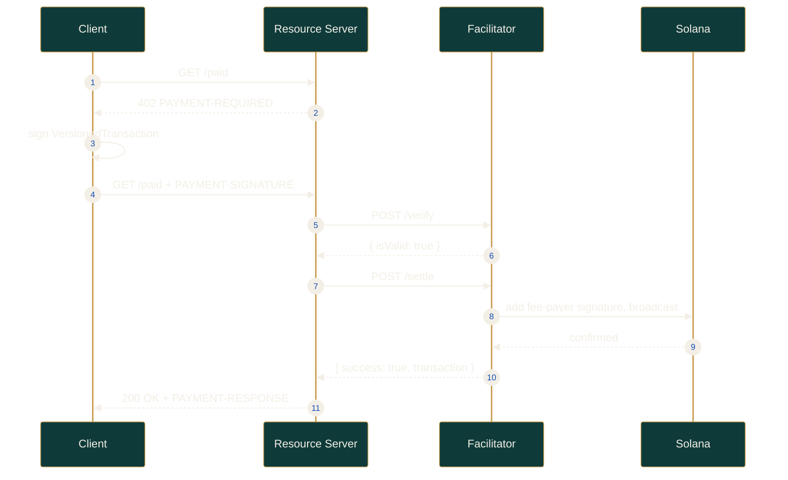

<div align="center">


<h1>Otomat</h1>

<p><em>Solana's x402 micropayment rail. Insert coin. Receive response.</em></p>

<p><b>English</b> · <a href="./README.ko.md">한국어</a></p>

<p>
  <a href="https://otomat.fun"></a>
  <a href="./docs"></a>
  <a href="https://github.com/otomat-fun/otomat/actions"></a>
  <a href="./LICENSE"></a>
  <br />
  <a href="https://github.com/otomat-fun/otomat/stargazers"></a>
  <a href="https://github.com/otomat-fun/otomat/commits/main"></a>
  <a href="https://www.rust-lang.org/"></a>
  <a href="https://www.anchor-lang.com/"></a>
  <a href="https://solana.com/"></a>
  <a href="https://www.typescriptlang.org/"></a>
</p>

</div>

## What is Otomat

Otomat is a payment rail for [x402](https://github.com/coinbase/x402) on Solana.
x402 revives the reserved HTTP `402 Payment Required` status code as a
machine-to-machine payment protocol: a server answers a request with a price, the
caller signs a payment, and the caller retries and gets its response. Otomat
implements that exchange end to end on Solana — an Anchor settlement program, an
`exact`-scheme decoder that matches the Coinbase SVM spec, a payment-channel scheme
for repeated calls, one-line monetization middleware, and a wallet kit for
autonomous agents.

The 1950s Automat is the mental model. There was no cashier: you dropped a coin,
turned the knob, and a glass door clicked open with a dish behind it. Money in,
door open — which is exactly what `402` is. A machine drops a coin and a machine
serves a response.

> **Status.** Pre-release. The `otomat-rail` program is deployed to Solana
> **devnet**; mainnet is targeted for a later milestone. The web app and hosted
> facilitator are in progress. Nothing here should custody mainnet funds yet.

## Why x402 on Solana

- **Per-call, not per-month.** This is push, per-request payment (`402`), not
  subscriptions or recurring pulls. An agent pays for exactly the calls it makes.
- **Gasless for the payer.** In the `exact` scheme the facilitator is the fee
  payer, so a caller with zero SOL can still pay in USDC.
- **Sub-second, sub-cent.** Solana's finality and fees make micropayments that
  are impractical elsewhere actually workable, which is the gap x402 needs filled.
- **Standards-compliant.** Otomat speaks x402 **v2** headers and follows the
  Coinbase SVM `exact` scheme byte for byte, then extends it with an
  `otomat-channel` scheme for batched sessions.

## Monorepo layout

```
otomat/
├── programs/otomat-rail/   Anchor 0.31 settlement program (Rust)
│   └── src/
│       ├── lib.rs                 8 instructions
│       ├── state.rs               Channel / Receipt / FacilitatorBond
│       ├── ed25519.rs             instructions-sysvar signature inspection
│       ├── instructions/          channel · receipt · facilitator
│       ├── constants.rs · errors.rs · events.rs
├── sdk/                    @otomat/sdk — payload builders, 402 client, MCP adapter
├── middleware/             @otomat/middleware — Express / Next / Hono adapters
├── payment-channel/        @otomat/payment-channel — off-chain checks + anchor I/O
├── agent-wallet-kit/       @otomat/agent-wallet-kit — budget / whitelist / time policies
├── docs/                   architecture · x402 compliance · settlement · security
└── tests/                  Anchor integration tests (mocha)
```

## Architecture

```mermaid
%%{init: {'theme': 'base', 'themeVariables': { 'primaryColor': '#0E3B3A', 'primaryTextColor': '#F3EFE6', 'primaryBorderColor': '#C79A4B', 'lineColor': '#E8B04B', 'secondaryColor': '#1C1A17', 'tertiaryColor': '#8C9196' }}}%%
flowchart LR
    subgraph Client
      A[Agent / app] --> SDK[@otomat/sdk]
      SDK --> AWK[agent-wallet-kit\nspend policy]
    end
    subgraph Server
      MW[@otomat/middleware\notomat price] --> RS[Your endpoint]
    end
    subgraph Rail
      FAC[Facilitator\nverify / settle]
      PRG[otomat-rail\nAnchor program]
    end
    SDK -->|402 -> PAYMENT-SIGNATURE| MW
    MW -->|verify / settle| FAC
    FAC -->|exact tx / close_channel| PRG
    PRG -->|escrow settlement| SOL[(Solana)]
```

## Quick start

The packages are workspace-linked and published as the rail stabilizes. For now,
clone and build:

```bash
git clone https://github.com/otomat-fun/otomat.git
cd otomat
pnpm install
pnpm build          # sdk, middleware, payment-channel, agent-wallet-kit
pnpm test           # 65 unit tests across the four packages
```

Turn any endpoint into a paid x402 API with one line of middleware:

```ts
import express from 'express';
import { otomat } from '@otomat/middleware';

const app = express();

app.get(
  '/api/premium',
  otomat.express({ price: '$0.002', payTo: 'YourSolanaPubkey' }),
  (req, res) => res.json({ data: 'premium content' }),
);
```

Pay a `402` transparently from a client or agent:

```ts
import { OtomatClient } from '@otomat/sdk';
import { Connection, Keypair } from '@solana/web3.js';

const client = new OtomatClient({
  facilitatorUrl: 'https://facilitator.otomat.fi',
  payer: Keypair.generate(),
  connection: new Connection('https://api.devnet.solana.com'),
});

// Transparently negotiates the 402 and returns the eventual 200.
const res = await client.fetch('https://api.example/paid');
```

Under the hood the wire exchange is plain HTTP:

```bash
# 1. No payment yet -> 402 with a base64(JSON) price list
curl -i https://api.example/paid
# HTTP/1.1 402 Payment Required
# PAYMENT-REQUIRED: eyJ4NDAyVmVyc2lvbiI6MiwiYWNjZXB0cyI6W3s...

# 2. Retry with the signed payment -> 200 with a settlement receipt
curl -i https://api.example/paid \
  -H "PAYMENT-SIGNATURE: eyJ4NDAyVmVyc2lvbiI6Miwic2NoZW1lIjoi..."
# HTTP/1.1 200 OK
# PAYMENT-RESPONSE: eyJzdWNjZXNzIjp0cnVlLCJ0cmFuc2FjdGlvbiI6...
```

## The x402 exchange



## Settlement program

`otomat-rail` (program id `FwFC1nDo5r224uXDeTMc2X8FhXuiz9CqBF7tg3trEVhN`) settles
payments over a single escrow channel and records receipts. Its instruction
surface:

```rust
#[program]
pub mod otomat_rail {
    // Escrow channel lifecycle
    pub fn open_channel(ctx: Context<OpenChannel>, deposit: u64, expiry: i64, facilitator: Pubkey) -> Result<()>;
    pub fn close_channel(ctx: Context<CloseChannel>, cumulative_amount: u64, nonce: u64, signature: [u8; 64]) -> Result<()>;
    pub fn dispute_channel(ctx: Context<DisputeChannel>, counter_cumulative: u64, counter_nonce: u64, counter_signature: [u8; 64]) -> Result<()>;
    pub fn resolve_dispute(ctx: Context<ResolveDispute>) -> Result<()>;
    pub fn timeout_reclaim(ctx: Context<TimeoutReclaim>) -> Result<()>;
    // Receipts and facilitator accountability
    pub fn commit_receipt(ctx: Context<CommitReceipt>, amount: u64, resource_hash: [u8; 32], nonce: u64, scheme: u8) -> Result<()>;
    pub fn open_facilitator_bond(ctx: Context<OpenFacilitatorBond>, amount: u64) -> Result<()>;
    pub fn slash_facilitator(ctx: Context<SlashFacilitator>, amount: u64, reason_hash: [u8; 32]) -> Result<()>;
}
```

Off-chain payer checks are authenticated with the Ed25519 native program and
inspected through the instructions sysvar; the signed message is rebuilt on-chain
so the program can confirm it matches the requested channel, amount, and nonce.
The program uses `anchor_spl::token_interface`, so one code path serves both SPL
Token and Token-2022. Details in [docs/settlement-spec.md](./docs/settlement-spec.md).

## Payment schemes

| Scheme | On-chain txns | Best for | Status |
| ------ | ------------- | -------- | ------ |
| `exact` | 1 per request | a single high-value call | Coinbase SVM spec |
| `otomat-channel` | 2 (open + close) | repeated calls in a session | Otomat-defined |
| `otomat-stream` | 2 + rebalances | continuous subscriptions | reserved for v2 |

## Documentation

- [Architecture](./docs/architecture.md) — how the pieces fit together
- [x402 compliance](./docs/x402-spec.md) — schemes, headers, deviations
- [Settlement spec](./docs/settlement-spec.md) — the on-chain program in detail
- [Security model](./docs/security.md) — trust assumptions and threat model

## Roadmap

- [x] `otomat-rail` program: escrow, three settlement paths, receipts, bond/slash
- [x] `exact` and `otomat-channel` payload builders and 402 client
- [x] Express / Next / Hono monetization middleware
- [x] Agent wallet kit spend policies
- [ ] Mainnet deployment of `otomat-rail`
- [ ] Hosted facilitator and Bazaar discovery index
- [ ] `otomat-stream` (Token-2022 transfer-hook streaming)

## Contributing

Contributions are welcome — see [CONTRIBUTING.md](./CONTRIBUTING.md). Please run
`pnpm lint`, `pnpm test`, and `cargo fmt` before opening a pull request, and
report anything security-sensitive per [SECURITY.md](./SECURITY.md).

## License

[MIT](./LICENSE) © 2026 Otomat

- [JMT x402 Agent Tools](https://jmt-x402-proxy.jmthomasofficial.workers.dev) — 25 paid x402 endpoints on Base mainnet: web search, AI analysis, crypto/stock data, SEC filings, company intel, news, sentiment, macro dashboard. $0.001-$0.15/call USDC. Local LLM-powered.