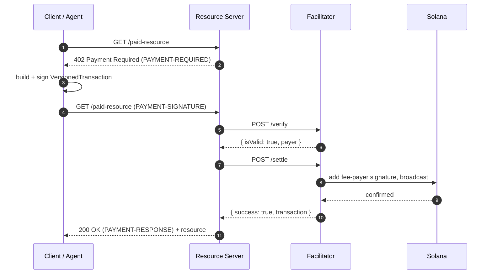

# Architecture

Otomat is a payment rail for the [x402](https://github.com/coinbase/x402)
protocol on Solana. It turns an HTTP `402 Payment Required` response into a
signed, verifiable, on-chain settlement so that a machine can pay another machine
per request. This document maps the pieces in this repository and how they fit
together.

## The x402 exchange

x402 reuses the reserved HTTP `402` status code as a three-header negotiation.
All three headers carry `base64(JSON)`:

- `PAYMENT-REQUIRED` — the server's price list (sent with the `402`).
- `PAYMENT-SIGNATURE` — the client's signed payment (sent on the retry).
- `PAYMENT-RESPONSE` — the settlement result (sent with the eventual `200`).



The facilitator is intentionally unauthenticated: any resource server can call
`/verify` and `/settle`, which lets many servers share one facilitator without
key management. Abuse is handled with IP-based rate limiting rather than auth.

## Repository layout

This repository is the open core of Otomat. The hosted facilitator, indexer, web
app, and browser extension live in separate repositories; the pieces below are
the parts meant to be embedded in your own code.

```
otomat/
├── programs/otomat-rail/   Anchor 0.31 settlement program (Rust)
├── sdk/                    @otomat/sdk — x402 v2 payload builders + client + MCP
├── middleware/             @otomat/middleware — Express / Next / Hono adapters
├── payment-channel/        @otomat/payment-channel — off-chain checks + anchor I/O
├── agent-wallet-kit/       @otomat/agent-wallet-kit — spend policies
├── docs/                   this documentation
└── tests/                  Anchor integration tests (mocha)
```

## Settlement schemes

Otomat supports two payment schemes and reserves a third.

| Scheme | On-chain txns | Best for | Status |
| ------ | ------------- | -------- | ------ |
| `exact` | 1 per request | a single high-value call | Coinbase SVM spec |
| `otomat-channel` | 2 (open + close) | repeated calls in a session | Otomat-defined |
| `otomat-stream` | 2 + rebalances | continuous subscriptions | reserved for v2 |

- **`exact`** follows the Coinbase SVM `exact` scheme byte for byte: a
  partially-signed `VersionedTransaction` with a strict instruction order
  (`SetComputeUnitLimit`, `SetComputeUnitPrice`, `TransferChecked`, optional
  memo/assertions). The facilitator is the fee payer, so a payer can pay with a
  zero-SOL balance. See [x402-spec.md](./x402-spec.md).
- **`otomat-channel`** accumulates off-chain payer-signed "checks" and settles
  the last one on-chain, in the spirit of a Lightning channel. See
  [settlement-spec.md](./settlement-spec.md).

## The settlement program

`programs/otomat-rail` is an Anchor 0.31 program (program id
`FwFC1nDo5r224uXDeTMc2X8FhXuiz9CqBF7tg3trEVhN`). It provides:

- **Escrow channels** — `open_channel` funds a `(payer, payee, mint)` escrow held
  by a PDA-owned associated token account.
- **Three settlement paths** — cooperative close (`close_channel`), unilateral
  close with a 120-second challenge window (`dispute_channel` +
  `resolve_dispute`), and payer reclaim on expiry (`timeout_reclaim`).
- **Receipts** — `commit_receipt` records an on-chain payment receipt for the
  `exact` and channel schemes.
- **Facilitator bond / slash** — `open_facilitator_bond` and `slash_facilitator`
  back a facilitator operator with a slashable bond.

Off-chain checks are authenticated with the Ed25519 native program: the payer's
signature is verified through the instructions sysvar, and the signed message is
reconstructed on-chain so the program can confirm it matches the requested
`(channel, cumulative, nonce, expiry)`.

The program uses `anchor_spl::token_interface`, so the same code path handles both
SPL Token and Token-2022 mints.

## Client and integration surface

- **`@otomat/sdk`** builds `exact` and `otomat-channel` payloads, drives the 402
  challenge/response loop over `fetch`, and adapts MCP tools so an agent pays for
  a tool call automatically.
- **`@otomat/middleware`** wraps any Express, Next.js App Router, or Hono handler
  with `otomat({ price })` to turn it into a paid endpoint.
- **`@otomat/payment-channel`** signs checks with the canonical message layout and
  assembles the Anchor instructions for channel open/close.
- **`@otomat/agent-wallet-kit`** enforces budget, whitelist, and time-window
  policies so an autonomous agent can pay within bounds set by its operator.

## Trust and non-goals

- Otomat is machine-to-machine, per-request payment. It is deliberately not a
  subscription or recurring-billing system, and it is not a consumer wallet-prompt
  flow like Solana Pay.
- A facilitator is trusted to broadcast a verified transaction and is held
  accountable by its bond. It never holds custody of channel funds; escrow is
  owned by a program PDA.

See [security.md](./security.md) for the full threat model.
