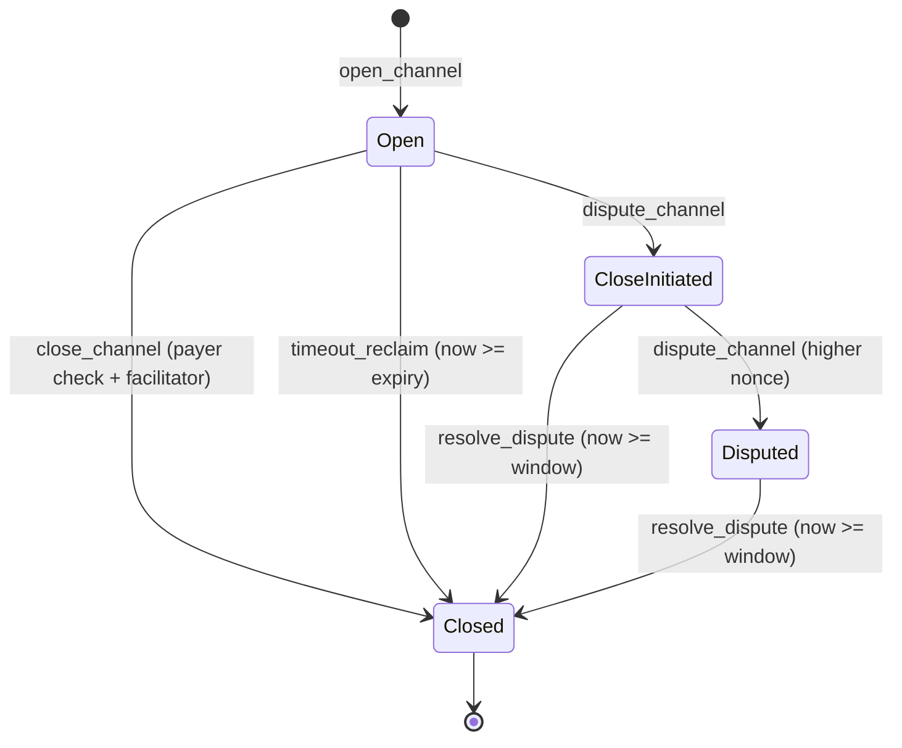

# Settlement Rail Specification

Design of `programs/otomat-rail` (Anchor 0.31.1): on-chain escrow, payment-channel
settlement, a receipt registry, and facilitator bond/slash for the Otomat x402
rail on Solana.

## 1. Summary

- **Program id:** `FwFC1nDo5r224uXDeTMc2X8FhXuiz9CqBF7tg3trEVhN` (kept in sync
  across `declare_id!`, `Anchor.toml`, and the deploy keypair).
- **Framework:** Anchor 0.31.1, `crate-type = ["cdylib", "lib"]`.
- **Token integration:** `anchor_spl::token_interface`, so one code path supports
  both SPL Token and Token-2022 via `TransferChecked` / `CloseAccount` CPIs.
- **Signature verification:** Anchor has no Ed25519 helper, so the Ed25519 native
  program is placed as the transaction's first instruction and inspected through
  `Sysvar<Instructions>` (§5).
- **Three settlement paths:** cooperative close (`close_channel`), unilateral close
  with a challenge window (`dispute_channel` → `resolve_dispute`), and expiry
  reclaim (`timeout_reclaim`).
- **Surface:** 8 instructions, 3 account types, 6 events, 17 errors.

## 2. PDA scheme

| Account | Seeds | Owner | Role |
| ------- | ----- | ----- | ---- |
| `Channel` | `[b"channel", payer, payee, mint]` | program | channel state (deposit, cumulative, nonce, expiry, status) |
| `EscrowAuthority` | `[b"escrow_auth", channel]` | program (PDA signer) | authority of the escrow ATA; no data |
| `Receipt` | `[b"receipt", payer, resource_hash, nonce_le]` | program | on-chain payment receipt |
| `FacilitatorBond` | `[b"facilitator_bond", operator]` | program | bond amount, slashed total, active flag |

The escrow vault is not a separate account; it is an associated token account
owned by `EscrowAuthority`. `open_channel` creates it (`init` + `associated_token`)
and the close paths return its rent to the payer with a `close_account` CPI.
Because `Channel` is an `init` PDA, a duplicate open for the same
`(payer, payee, mint)` fails while a channel is active and becomes reusable after
close.

## 3. State accounts

### `Channel`

| Field | Type | Meaning |
| ----- | ---- | ------- |
| `payer` | `Pubkey` | funder; the only party whose checks are honored |
| `payee` | `Pubkey` | recipient of settled funds |
| `mint` | `Pubkey` | escrowed SPL / Token-2022 mint |
| `facilitator` | `Pubkey` | authorized to cooperatively close |
| `deposit` | `u64` | total escrowed amount |
| `cumulative_paid` | `u64` | highest verified cumulative amount |
| `nonce` | `u64` | highest verified check nonce (monotonic) |
| `expiry` | `i64` | unix ts after which the payer may reclaim |
| `status` | `ChannelStatus` | `Open` / `CloseInitiated` / `Closed` / `Disputed` |
| `dispute_window_end` | `i64` | challenge-window end (0 when not disputing) |
| `bump`, `escrow_bump` | `u8` | PDA bumps |

`Receipt` stores `payer, payee, amount, mint, resource_hash[32], nonce, timestamp,
scheme` (`scheme`: 0 = exact, 1 = otomat-channel, 2 = otomat-stream).
`FacilitatorBond` stores `operator, bond_amount, bond_mint, slashed, active,
last_settle_ts`.

## 4. Instructions

### `open_channel(deposit, expiry, facilitator)`

Transfers `deposit` from the payer's ATA to the escrow ATA, then initializes the
channel (`status = Open`, `nonce = 0`). Requires `deposit > 0` and
`expiry > now`. Emits `ChannelOpened`.

### `close_channel(cumulative_amount, nonce, signature)`

Cooperative immediate settlement. Verifies the payer-signed check via the Ed25519
pre-instruction, transfers `cumulative_amount` to the payee, refunds the remainder
to the payer, and closes the escrow ATA and channel. The `facilitator` signer must
equal `channel.facilitator`. Requires `status == Open`, `nonce > channel.nonce`,
and `cumulative_amount <= deposit`. Emits `ChannelClosed`.

### `dispute_channel(counter_cumulative, counter_nonce, counter_signature)`

Permissionless — the check signature is the real authority. Submits a
higher-nonce payer-signed check to open or extend a unilateral close, setting
`dispute_window_end = now + 120s`. `Open → CloseInitiated`; otherwise `→ Disputed`.
Requires `status != Closed`, `counter_nonce > channel.nonce`, and
`counter_cumulative <= deposit`. Emits `ChannelDisputed`.

### `resolve_dispute()`

Finalizes a disputed/unilaterally-closed channel after the window. Pays the
recorded `cumulative_paid` to the payee, refunds the payer, and closes. Requires
`status ∈ {CloseInitiated, Disputed}` and `now >= dispute_window_end`. Emits
`ChannelClosed`.

### `timeout_reclaim()`

Payer reclaims the full escrow once the channel has expired without a close.
Requires `status == Open` and `now >= expiry`. Emits `ChannelClosed` with
`cumulative = 0`, `refund = deposit`.

### `commit_receipt(amount, resource_hash, nonce, scheme)`

Records an on-chain receipt for an `exact` or channel payment. Requires
`amount > 0` and `scheme <= 2`. Emits `ReceiptCommitted`.

### `open_facilitator_bond(amount)`

Deposits `amount` from the operator's ATA into a bond vault (ATA owned by the bond
PDA) and initializes the bond (`active = true`). Requires `amount > 0`. Emits
`FacilitatorBonded`.

### `slash_facilitator(amount, reason_hash)`

Governance-signed. Transfers `amount` from the bond vault to a slash destination
(signed by the bond PDA), adds to `slashed`, and clears `active` once `slashed >=
bond_amount`. Requires the signer to equal `GOVERNANCE_PUBKEY` and
`amount <= bond_amount - slashed`. Emits `FacilitatorSlashed`.

## 5. Ed25519 check verification

### Canonical message

72 bytes, concatenated:

```
"otomat/v2/check|" (16B) || channel_pda (32B) || cumulative_le (8B) || nonce_le (8B) || expiry_le (8B)
```

`build_check_message()` reconstructs it on-chain; the SDK and payment-channel
builders sign the identical layout. `expiry` uses the stored `channel.expiry` to
prevent tampering.

### Procedure (`ed25519.rs`)

1. Load the transaction's first instruction with `load_instruction_at_checked(0, ..)`.
2. Confirm `program_id == Ed25519 native program` (else `MissingEd25519Instruction`).
3. Parse the `Ed25519SignatureOffsets` header and extract the pubkey (32),
   signature (64), and message slices with bounds checks.
4. Require exactly one signature.
5. Assert `pubkey == channel.payer`, `signature == argument`, and
   `message == build_check_message(..)` (else `InvalidSignature` / `MessageMismatch`).

The native program proves the signature is cryptographically valid; this routine
proves the verified `(pubkey, message, signature)` are the ones the program
requires. The facilitator builds the transaction with the Ed25519 instruction at
index 0 and the settlement instruction at index 1 (Anchor:
`.preInstructions([ed25519Ix])`).

## 6. Channel state machine



- `close_channel` is **cooperative immediate settlement**: a payer-signed latest
  check plus a bonded facilitator's signature represents both sides, so it is safe
  to finalize at once.
- `dispute_channel` + `resolve_dispute` is **unilateral close with a challenge**:
  one side settles from its latest check without the facilitator, and the other has
  120 seconds to override with a higher-nonce check. Monotonic nonces plus on-chain
  signature checks void outdated state in place of Lightning-style forfeiture.

## 7. Events

`ChannelOpened`, `ChannelClosed`, `ChannelDisputed`, `ReceiptCommitted`,
`FacilitatorBonded`, `FacilitatorSlashed`.

## 8. Errors

`InvalidSignature`, `NonceNotIncreasing`, `CumulativeExceedsDeposit`,
`ChannelExpired`, `ChannelNotExpired`, `InvalidChannelStatus`,
`MissingEd25519Instruction`, `MessageMismatch`, `InvalidTokenProgram`,
`FacilitatorMismatch`, `GovernanceMismatch`, `BondInsufficient`,
`BondAlreadyActive`, `DisputeWindowActive`, `InvalidScheme`, `ZeroAmount`,
`InvalidExpiry`.

## 9. Design decisions

- **No direct `solana-program` dependency.** Only `anchor_lang::solana_program`
  re-exports are used (`ed25519_program::ID`, `sysvar::instructions::*`, `pubkey!`)
  to keep the `Pubkey` / `AccountInfo` types version-consistent with anchor-lang
  0.31.1.
- **BPF 4 KB stack frames.** Settlement paths that hold several
  `token_interface` CPIs overflow a single frame. Each CPI lives in an
  `#[inline(never)]` helper (`escrow_transfer` / `escrow_close`) so it occupies its
  own frame, and interface accounts are `Box`ed to shrink the `try_accounts` frame.
- **Governance is hardcoded in v1** (`GOVERNANCE_PUBKEY`), used only for slashing;
  migration to an on-chain governance program is a v2 item.
- **120-second dispute window** (`DISPUTE_WINDOW_SECONDS`), kept short so the
  latest check wins quickly.

## 10. Not yet implemented

- On-chain Token-2022 extension filtering (fee-on-transfer, transfer-hook
  whitelist, confidential-transfer rejection) — enforced off-chain today.
- The `otomat-stream` scheme (id 2 is reserved and recorded in receipts only).
- Bond top-up, partial withdrawal, and unbond delay (v1 is one bond per operator,
  slash only).

## 11. Build and test

```bash
cargo fmt --all -- --check
cargo check --workspace
anchor build        # target/idl/otomat_rail.json + target/types/otomat_rail.ts
anchor test         # local validator, tests/otomat-rail.ts
```

The IDL `address` equals `declare_id!` equals the program id above. Mainnet
deployment flips `Anchor.toml` `[provider] cluster` to `mainnet` and runs
`anchor deploy --provider.cluster mainnet`.
